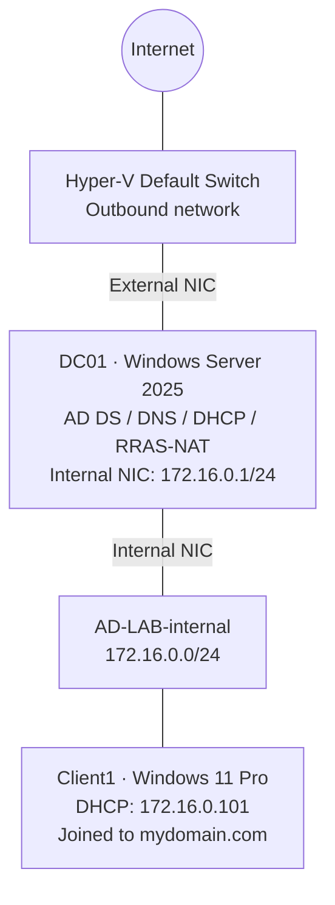

# Active Directory Home Lab
### Windows Server 2025 · Windows 11 Pro · Microsoft Hyper-V

A virtualized Windows domain environment built to practice Active Directory administration, Windows networking, identity management, and endpoint support. The lab runs on a Windows 11 Pro host using Hyper-V, with a Windows Server 2025 domain controller and a Windows 11 Pro domain-joined workstation.

The first phase is **complete and validated**: the workstation receives its network configuration from the domain controller, resolves Active Directory services, reaches the internet through NAT, joins the domain, and authenticates using a domain account. This repository will grow as I complete more administrative, security, and troubleshooting exercises.

**[Build guide](BUILD.md) · [Implementation evidence](#implementation-milestones) · [Troubleshooting](#troubleshooting--lessons-learned) · [Next exercises](#next-exercises)**

---

## Project Objectives

- Build a functional on-premises-style Active Directory environment without relying on cloud infrastructure.
- Configure core Windows network services: DNS, DHCP, routing, and NAT.
- Join a Windows client to the domain and validate centralized authentication.
- Establish a reusable environment for user administration, automation, Group Policy, and help desk troubleshooting.

## Lab Environment

| Component | Configuration |
|:---|:---|
| Host / hypervisor | Windows 11 Pro / Microsoft Hyper-V |
| Domain controller | `DC01` — Windows Server 2025 Standard Evaluation |
| Client workstation | `Client1` — Windows 11 Pro |
| AD domain / NetBIOS | `mydomain.com` / `MYDOMAIN` |
| Domain services | AD DS, DNS, DHCP, Routing and Remote Access (RRAS) / NAT |
| Internal virtual switch | `AD-LAB-internal` |
| External connectivity | Hyper-V Default Switch connected to DC01's second virtual NIC |
| Directory organization | `_ADMINS` and `_EMPLOYEES` organizational units |

## Network Architecture

DC01 connects to **two virtual networks**: the lab network for internal domain services, and the Hyper-V Default Switch for outbound access. Client1 connects to the lab network and uses DC01 as its DNS server, DHCP server, and default gateway.



### IP Addressing and Services

| Network setting | Configured value |
|:---|:---|
| Domain controller's internal IPv4 | `172.16.0.1/24` |
| DHCP scope | `172.16.0.100`–`172.16.0.200` |
| Client address obtained through DHCP | `172.16.0.101` |
| Client default gateway | `172.16.0.1` |
| Client DNS server | `172.16.0.1` |
| Domain controller's internal DNS setting | `127.0.0.1` |
| DNS forwarder used after troubleshooting | `1.1.1.1` |

> **Design note:** The domain controller supplies the internal network services; the client does not connect directly to the Hyper-V Default Switch.

## Implementation Milestones

Rather than embedding a screenshot after every step, each reference number links to the corresponding evidence in the [`screenshots/`](screenshots/) folder. A detailed walkthrough is available in [BUILD.md](BUILD.md).

| Phase | What I implemented | Evidence |
|:---|:---|:---:|
| **Server networking** | Configured DC01's internal IPv4 address and virtual networking for lab connectivity. | [03](screenshots/03-DC01-Network-Configuration.png) |
| **Domain configuration** | Created the `mydomain.com` domain and verified it in Active Directory Domains and Trusts. | [04](screenshots/04-Active-Directory-Domain-Configuration.png) |
| **Active Directory** | Installed AD DS and promoted Windows Server 2025 to a domain controller. | [05](screenshots/05-ADDS-Role-Installed.png) |
| **Routing services** | Installed Remote Access and configured RRAS/NAT for outbound client connectivity. | [06](screenshots/06-Remote-Access-Role-Installation.png) |
| **DHCP** | Configured the IPv4 address pool and domain network options. | [07](screenshots/07-DHCP-Scope-Configuration.png) |
| **Directory structure** | Created `_ADMINS` and `_EMPLOYEES` OUs and a dedicated domain administrative account. | [08](screenshots/08-Active-Directory-Users-and-Organizational-Units.png) |
| **Domain join** | Joined `Client1` to `mydomain.com` and verified its computer object in Active Directory Users and Computers. | [09](screenshots/09-Client1-Verified-in-Active-Directory.png) |
| **Authentication** | Signed into Client1 using `MYDOMAIN\Administrator` and confirmed the identity with `whoami`. | [10](screenshots/10-Successful-Domain-Authentication.png) |

*Screenshots 01–02 document the earlier Hyper-V and server setup; their exact filenames will be checked when the local evidence folder is uploaded.*

## Validation Results

I verified the environment from the Windows client rather than relying only on successful role installations.

| Verification | Observation | Status |
|:---|:---|:---:|
| DHCP lease | Client1 received `172.16.0.101` with gateway/DNS `172.16.0.1`. | Passed |
| Network connectivity | `ping 172.16.0.1` succeeded with no packet loss. | Passed |
| Domain name resolution | `nslookup mydomain.com` resolved successfully. | Passed |
| AD service discovery | `_ldap._tcp.dc._msdcs.mydomain.com` returned an LDAP SRV record for DC01. | Passed |
| External connectivity | Client1 successfully resolved and pinged `www.google.com`. | Passed |
| Domain join | `CLIENT1` appeared in the domain's `Computers` container. | Passed |
| Domain sign-in | `whoami` on Client1 returned `mydomain\administrator`. | Passed |

Example validation commands used during testing:

```powershell
ipconfig /all
ping 172.16.0.1
nslookup mydomain.com
nslookup -type=SRV _ldap._tcp.dc._msdcs.mydomain.com
ping www.google.com
whoami
```

## Troubleshooting & Lessons Learned

### DNS forwarder stopped resolving external domains

**Issue.** DC01 could establish outbound TCP connectivity, but external DNS lookups failed. A previously configured DNS forwarder (`172.22.80.1`) no longer worked after the Hyper-V Default Switch network changed.

**Investigation.** I separated the connectivity test from the DNS test: outbound access was available, but hostnames were not resolving. This pointed to the forwarding configuration rather than a complete loss of internet access.

**Resolution.** Updated the DNS forwarder to `1.1.1.1` and verified that `Resolve-DnsName google.com` succeeded. Microsoft Edge was also able to load Google afterward.

**Takeaway.** Working IP connectivity does not guarantee working DNS. Testing these separately makes network troubleshooting more efficient.

### Other configuration lessons

| Challenge | What I learned |
|:---|:---|
| Windows 11 installation in Hyper-V | The client VM needed Secure Boot and a virtual TPM enabled. |
| Domain discovery | Clients need to use the domain controller's DNS service so Active Directory records can be resolved. |
| Domain-join verification | A successful join message should be followed by checking the computer object and performing a real domain sign-in. |
| Internal vs. external networking | Keeping the client on the lab switch while routing through DC01 helped separate domain traffic from outbound access. |

## Skills Demonstrated

**Windows administration:** Windows Server 2025, Windows 11 Pro, AD DS, domain joins, Active Directory Users and Computers, administrative account setup.

**Networking:** Hyper-V virtual networking, IPv4 addressing, DNS, DHCP, LDAP service discovery, default gateways, RRAS, NAT, connectivity testing.

**Troubleshooting & validation:** Command Prompt, PowerShell DNS testing, isolating network-vs-DNS failures, documenting evidence of authentication and service availability.

## Next Exercises

This is an evolving home lab. These are **planned**, not completed, activities:

- [ ] Provision standard domain users and manage account lifecycle tasks.
- [ ] Practice password resets, account unlocks, group membership, and help desk scenarios.
- [ ] Develop and document PowerShell automation for routine Active Directory tasks.
- [ ] Configure and validate Group Policy settings on Client1.
- [ ] Practice and document troubleshooting scenarios, including domain logon and DNS failures.
- [ ] Rebuild key portions of the environment independently to reinforce the setup process.

## Repository Guide

```text
active-directory-home-lab/
├── README.md             # Overview, results, evidence, and roadmap
├── BUILD.md              # Detailed implementation and validation steps
├── screenshots/          # Numbered proof of lab milestones
├── images/               # Optional architecture graphics
└── scripts/              # Future scripts written or adapted for this lab
```

The core lab is complete; advanced configuration exercises will be added only after they have been implemented and tested. See the [build guide](BUILD.md) for the setup process.

---

*This repository describes a personal training lab. It does not represent a production deployment.*
